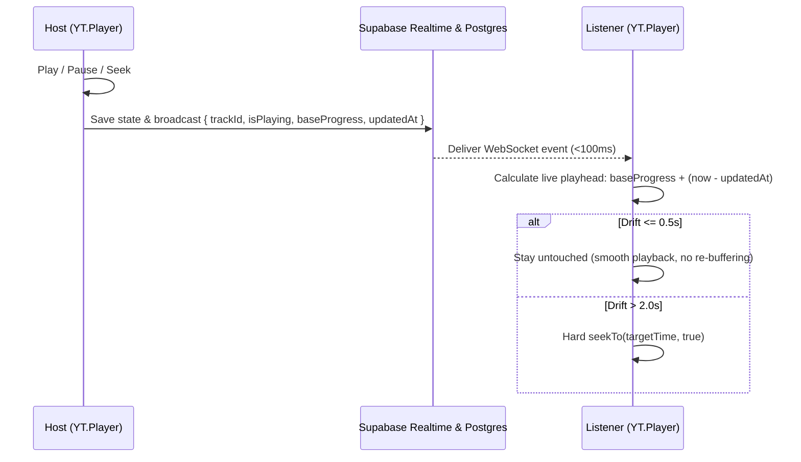

```markdown
# NOCTURNE

**Music hits different together.**  
NOCTURNE is a real-time communal listening room app built with **Next.js**, **TypeScript**, **Supabase**, and the **YouTube IFrame API**. Spin up a room in seconds, drop single YouTube links or full playlists into a shared queue, chat live, and listen in lockstep with friends—no account required.

🔗 **Live Demo:** [nocturne-steel-xi.vercel.app](https://nocturne-steel-xi.vercel.app)

---

## Why I Built This
Most shared music apps either require everyone to pay for the same streaming subscription or force a host to stream compressed audio over screen-share. I wanted something fast and zero-friction: a lightweight room where YouTube handles the heavy audio/video delivery directly on each person's device, while a thin WebSocket state layer keeps everyone's playhead synced to the exact second.

---

## How It Works Under the Hood

### 1. Lockstep Playback Sync (Without Audio Re-Streaming)
Instead of streaming media through a central server, NOCTURNE broadcasts a tiny state payload (`trackId`, `isPlaying`, `baseProgress`, `updatedAt`) over **Supabase Realtime** whenever the host plays, pauses, skips, or seeks.



* **Live Timestamp Math:** Every listener computes where the track should be right now using `basePositionSeconds + (now - updatedAt) / 1000`.
* **Deadband Tolerance & Loop Guards:** Small network jitter under `0.5s` is ignored so audio never stutters, while monotonic seek locks (`lastSeekTimestampRef`) prevent programmatic `seekTo()` calls from triggering infinite broadcast loops.
* **Direct Hardware Volume Bridge:** Connects the custom studio volume slider and mute toggle directly to the underlying `YT.Player` instance (`window.__nocturneYtPlayer`) so local volume changes respond instantaneously without fighting iframe state delays.

---

### 2. Database Security & Multi-Tenant Room Isolation

Even though guests can jump in without creating a password, room boundaries are enforced at the PostgreSQL layer using **Row-Level Security (RLS)**:

* **Scoped Visitor Tokens:** Every guest gets a cryptographically scoped session token checked across all database tables.
* **Private Room Protection:** Private rooms, queues, and Realtime channels validate active room membership (`room_memberships`). Unauthorized requests receive a `404` with `Cache-Control: no-store`.
* **Queue Rules & Role Controls:** Queues operate in strict FIFO order (capped at 50 tracks). Listeners can remove tracks they added, while hosts retain full queue moderation and session recovery.
* **Automated Stale-Room Cleanup:** A `CRON_SECRET`-protected cleanup route sweeps abandoned rooms on schedule while leaving active or featured rooms untouched.

---

### 3. Curated Starter Tapes, Playlists & Responsive Studio UI

* **One-Click Starter Tapes:** Curated rooms (*After Hours Electronic*, *Sub-Bass & Rain*, *Midnight Analog*, *Code & Deep Focus*) let visitors launch a pre-seeded session immediately and automatically deduplicate against live rooms.
* **Single Video & Playlist Batch Import:** Paste any standard YouTube link or a full playlist URL (`youtube.com/playlist?list=...`) to resolve metadata and enqueue up to 15 tracks in FIFO order.
* **Dark & Light Studio Themes:** Semantic CSS tokens power both **Midnight Studio** (`#09090D`) and **Daylight Studio** (`#F6F5F8`) modes while keeping the video viewport pure black (`#000000`).
* **Mobile-First Ergonomics (`< 1024px`):** Uses a `100dvh` layout with a compact `48px` header, a persistent `40px` `Up Next` bar that opens a `75dvh` slide-up queue sheet, and full-time bottom chat.

---

## Tech Stack

* **Frontend:** Next.js (Pages Router), React 18, TypeScript, Tailwind CSS
* **Backend & Realtime:** Supabase (PostgreSQL, Row-Level Security, Realtime Broadcast & Presence, SQL RPCs)
* **Media & Metadata:** YouTube IFrame Player API + Server-Side Track & Playlist Resolver
* **Testing:** Node.js native test runner (`46` automated unit & integration tests) + Playwright E2E checks

---

## Automated Test Suite (`46 / 46 Passing`)

```bash
node --test tests/targeted-fixes.test.mjs           # 9/9   - ISO 8601 duration parsing, room limits, theme tokens
node --test tests/playback-sync.test.mjs            # 9/9   - Drift correction, playhead capture, navigation invariants
node --test tests/permissions-regressions.test.mjs  # 20/20  - RLS isolation, token auth, queue caps, Realtime policies
node --test tests/cleanup-security.test.mjs         # 8/8   - Fail-closed CRON_SECRET auth & stale room pruning

```

---

## Running Locally

1. **Clone & install dependencies:**
```bash
git clone [https://github.com/amanraj88/nocturne.git](https://github.com/amanraj88/nocturne.git)
cd nocturne
npm install

```


2. **Add `.env.local` in the root folder:**
```env
NEXT_PUBLIC_SUPABASE_URL=[https://your-project-id.supabase.co](https://your-project-id.supabase.co)
NEXT_PUBLIC_SUPABASE_ANON_KEY=your-supabase-anon-key
SUPABASE_SERVICE_ROLE_KEY=your-supabase-service-role-key
CRON_SECRET=your-secure-cron-secret

```


3. **Apply migrations & start the dev server:**
Run the SQL migrations in `supabase/migrations/` inside your Supabase SQL Editor, then start the app:
```bash
npm run dev

```


Open [http://localhost:3000](http://localhost:3000).

---

## Author

**Aman Raj** — [@amanraj88](https://github.com/amanraj88)

```

```
